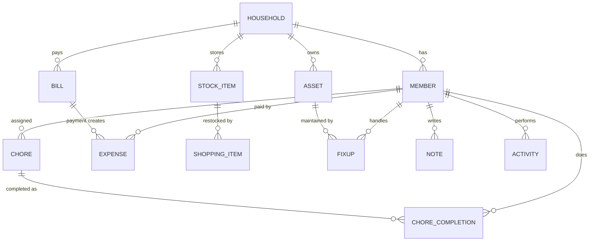

# Hearth — A Unified Household Management and Coordination System

> **Happy Home. Organized Home.**
> One place for a household's chores, bills, groceries, repairs and shared responsibilities.

Hearth is a mobile-first app (installable Progressive Web App) that brings everyday home
responsibilities into one organised platform. A central dashboard called **House Pulse** shows
the overall health of the home and highlights what needs attention, while a rule-based
**Smart Hearth** layer turns household data into reminders and suggestions.

Mini Project 1A (CEM301) · Department of Computer Engineering · SIES Graduate School of Technology

**Team:** Amrita Sudarshini Nixon Nadar · Yutika Rajaseelan Nadar · Tanishka Nair

---

## Modules

| Module | What it does |
|---|---|
| **House Pulse** (Dashboard) | House Health Score (0–100), streak, stat cards, today's chores, upcoming bills, low stock, fix-ups, quick actions |
| **Daily Rhythm** (Chores) | Create, assign, prioritise and repeat chores (daily / weekly / monthly), tick them off, effort points, fair-share analysis |
| **Money Watch** (Bills & expenses) | Bills with due dates, paid/unpaid status, recurring cycles, autopay flag; expense log with category summary |
| **Pantry Pulse** (Stock & shopping) | Quantity tracking with low-stock thresholds, expiry tracking, shopping list with *Smart fill*; ticking an item restocks the pantry |
| **Home Care** (Fix-ups & maintenance) | Repairs and maintenance tasks, appliance register, service intervals, warranty tracking, repair history and costs |
| **Household** (Members & roles) | Members with roles **Admin / Member / Helper** and role-based permissions, invite code |
| **Smart Hearth** (Automation) | 11 rules generate alerts & suggestions with one-tap actions (pay bill, add to list, log service) |
| **Insights** | Health-score trend, fairness index, chores per day, monthly spending, category breakdown, pantry health |
| **Reports** | Printable monthly household report (Print → Save as PDF) |
| **Calendar · Notes · Activity · Search** | Unified calendar of every dated item, shared notes, full activity history ("who did what"), global search |

## Key algorithms

**House Health Score** (`src/logic/score.ts`): weighted sum of five components:

| Component | Weight | Measure |
|---|---|---|
| Chores | 30 | done today ÷ (done today + due/overdue) |
| Bills | 25 | per bill: overdue = 0, due ≤ 3 days = 0.5, else 1 |
| Stock | 20 | items above their low-stock threshold ÷ all items |
| Maintenance | 15 | per appliance / fix-up: overdue = 0, due ≤ 7 days = 0.5, else 1 |
| Consistency | 10 | household streak ÷ 7 (capped) |

**Fair share** (`src/logic/fairness.ts`): uses **Jain's fairness index**
`J = (Σxᵢ)² / (n · Σxᵢ²)` over effort points completed in the last 30 days.
`J = 1` means perfectly equal work; `J = 1/n` means one person does everything.
A member doing more than 1.5× an equal share is flagged with a suggestion.

**Smart Hearth rules** (`src/logic/rules.ts`): each rule is a pure function
`(householdData, today) → Alert[]`: overdue bills, bills due soon, low stock, expiry,
maintenance due, warranty expiring, overdue chores, fair share, spending spike (> 130 % of last
month), stale repairs, streak keeper. Alerts are derived, never stored; only dismissals are saved.

## Tech stack

- **React 18 + TypeScript**, built with **Vite**
- **Tailwind CSS** for the UI, **lucide-react** icons, **Recharts** for charts
- **Zustand** state store, persisted on the device (offline-first, no server needed)
- **vite-plugin-pwa**: installable app, offline support, home-screen icon, device notifications
- **Vitest**: unit tests for the score, fairness, streak and rules engine

## Project structure

```
src/
  types.ts            data model (one interface per "table")
  store/useHearth.ts  local database + all actions (each action writes to the activity log)
  data/seed.ts        demo household (dates are relative to today)
  logic/              pure business logic: score, fairness, streak, rules, calendar, permissions
  components/         Layout (top bar, tab bar, drawer), shared UI, list rows
  pages/              one file per screen
  lib/                date / currency helpers, notifications, hooks
```

### Data model (ER overview)



---

## Run it on a Windows laptop

### 1. Install (one time)

1. **Node.js LTS**: download from <https://nodejs.org> → "LTS" → install with default options.
2. **Git**: <https://git-scm.com/download/win> → install with default options.
3. **VS Code**: <https://code.visualstudio.com>.

Check in a new **Command Prompt** or **PowerShell** window:

```powershell
node -v
npm -v
git --version
```

### 2. Get the project

```powershell
git clone https://github.com/amritanbk-2407/hearth.git
cd hearth
code .
```

(Or unzip the project folder and open it in VS Code with *File → Open Folder*.)

### 3. Install and start

In VS Code open the terminal (**Ctrl + `**) and run:

```powershell
npm install
npm run dev
```

Open the link shown (usually <http://localhost:5173>). On a laptop the app appears inside a phone
frame. Click **Explore the demo home** to load sample data.

> If PowerShell says *"running scripts is disabled"*, run this once and retry:
> `Set-ExecutionPolicy -Scope CurrentUser RemoteSigned`

### 4. Other commands

| Command | Purpose |
|---|---|
| `npm test` | run the unit tests |
| `npm run build` | production build into `dist/` |
| `npm run preview` | preview the production build |

### Open it on a phone during development

Run `npm run dev -- --host`, then open the `Network:` URL on a phone connected to the same Wi-Fi.

## Install on iPhone (the demo)

1. Open the live link (`https://amritanbk-2407.github.io/hearth/`) in **Safari**.
2. Tap **Share** → **Add to Home Screen** → **Add**.
3. Open **Hearth** from the home screen. It runs full-screen like a native app and works offline.

On Android: open in Chrome → ⋮ menu → **Install app**.

## Deployment

Every push to `main` runs `.github/workflows/deploy.yml`, which tests, builds and publishes the
app to the `gh-pages` branch. GitHub Pages serves that branch at https://amritanbk-2407.github.io/hearth/
(repo Settings → Pages → Deploy from a branch → `gh-pages` / `(root)`). The repository must be public
for Pages to work on a free account.

## Future scope

- Cloud sync and real accounts (e.g. Supabase / Firebase) so all members share one household in real time
- Push notifications from a server, UPI bill-payment deep links
- Barcode scanning for groceries, receipt photo capture
- Native iOS / Android builds (Capacitor) for the app stores
